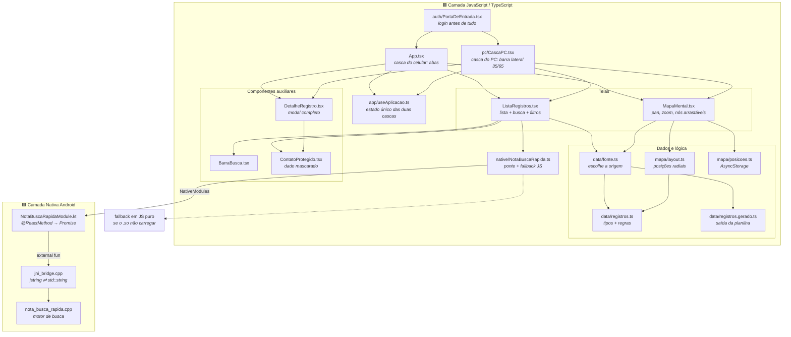
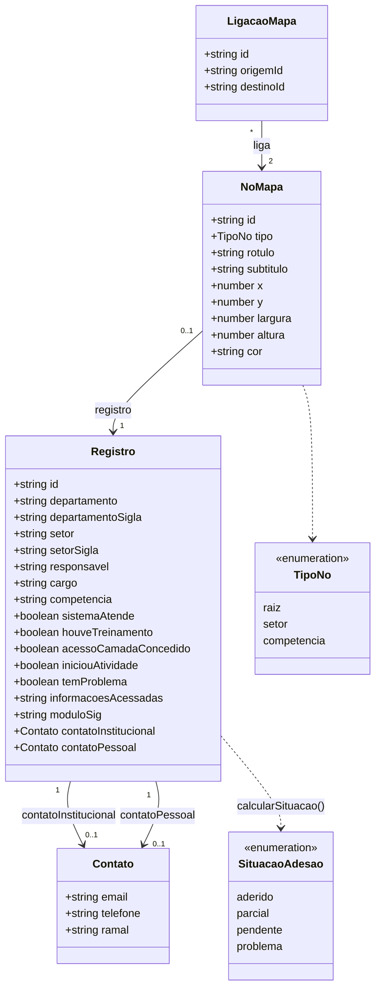
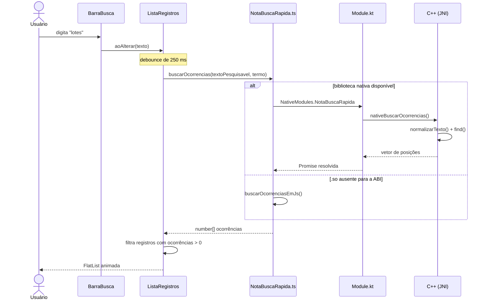

# NotaDASI

## Como rodar

**No PC (navegador) — o jeito mais rápido, não precisa de celular nem emulador:**

```bash
npm install
npm run dev
```

Abra **http://localhost:5173**.

**No Android (aparelho ou emulador):**

```bash
npm install
npm run android
```

Nos dois alvos o app pede uma conta na entrada. As três que existem numa
instalação nova:

| Conta | Senha inicial |
|---|---|
| `DASI` | `dasi` |
| `GERENTE - DGEO` | `gerente` |
| `SECRETARIO` | `secretario` |

A senha é trocável em *Ajustes → Conta*, e a sessão fica salva — só é pedida de
novo se você sair. Ver [Contas e acesso](#contas-e-acesso).

Os dois alvos rodam o **mesmo código** (`App.tsx` + `src/`) e carregam a **mesma
base de dados** (as competências de `src/data/registros.gerado.ts`). O que muda
é só a **casca**: as abas embaixo no celular, a barra lateral com o mapa em foco
no PC. O alvo PC vive em [`pc/`](pc/) — veja [pc/README.md](pc/README.md) para
os detalhes, inclusive o que **não** é compartilhado entre os dois.

> **Na rede da Prefeitura**, `registry.npmjs.org` está bloqueado pelo firewall.
> Se o `npm install` travar ou der `ECONNRESET`, use o espelho oficial:
> `npm install --registry https://registry.yarnpkg.com`

---

Aplicativo para consulta do **levantamento de competências e adesão ao SIG** (Prefeitura de Porto Velho). Cada registro é uma competência de um setor, com as respostas sobre como o SIG atende (ou não) aquela atividade.

O app combina três camadas de tecnologia:

- **React Native (TypeScript)** — interface, lista de competências, mapa mental interativo e animações (`react-native-reanimated`).
- **C++ (NDK/CMake)** — busca de texto normalizada (sem acento, case-insensitive), exposta ao JavaScript via módulo nativo (JNI).
- **XML nativo (Android)** — layout de cabeçalho de referência para componentes nativos customizados.

---

## Visão geral (mapa mental da arquitetura)



### Modelo de dados (visão UML)



> Os campos `boolean` de `Registro` são **opcionais** no TypeScript: `undefined` significa *"não respondido"* (o `-` da planilha), que é diferente de `false`. Toda a UI trata os três estados — `Sim` / `Não` / `—`.

### Fluxo de uma busca (ponta a ponta)



---

## Estrutura do projeto

```
App.tsx                            Casca do celular (abas) + provedores
index.js                           Entrada do React Native (AppRegistry)

src/
  app/
    useAplicacao.ts                Estado do app — o MESMO nas duas cascas
    Modais.tsx                     Detalhe e formulários, por cima de qualquer tela
  auth/
    contas.ts                      Contas padrão, normalização e hash da senha
    useSessao.tsx                  Sessão salva no AsyncStorage (provedor + hook)
    TelaLogin.tsx                  Tela de entrada (a mesma no celular e no PC)
    PortaDeEntrada.tsx             Decide entre login e app
    SecaoConta.tsx                 Bloco "Conta" em Ajustes (trocar senha, sair)
  components/
    ListaRegistros.tsx             Tela de lista: busca, filtros por setor, cartões
    BarraBusca.tsx                 Campo de texto + botão Buscar
    DetalheRegistro.tsx            Modal com todos os campos do registro
    ContatoProtegido.tsx           Contato pessoal mascarado (toque para revelar)
  data/
    registros.ts                   Tipos (Registro, Contato), regras e dados de exemplo
    fonte.ts                       Decide entre dados da planilha e dados de exemplo
    registros.gerado.ts            Gerado pelo script de importação (não editar à mão)
  mapa/
    MapaMental.tsx                 Tela do mapa: câmera (pan/zoom) e nós arrastáveis
    layout.ts                      Monta os nós/ligações e calcula o layout radial
    posicoes.ts                    Persiste as posições arrastadas (AsyncStorage)
  native/
    NotaBuscaRapida.ts             Ponte com o módulo nativo + fallback em JS puro

cpp/
  nota_busca_rapida.h/.cpp         Busca normalizada e descriptografia simulada
  jni_bridge.cpp                   Ponte JNI (Kotlin ⇄ C++)
  CMakeLists.txt                   Build da libnota_busca_rapida.so

android/
  app/src/main/jni/CMakeLists.txt  Integra o CMake do React Native + o nosso C++
  app/src/main/java/com/notadasi/
    NotaBuscaRapidaModule.kt       Módulo nativo exposto ao JS
    NotaBuscaRapidaPackage.kt      Registro do módulo
    MainApplication.kt             Registro do package no React Native
    MainActivity.kt                Activity principal
  app/src/main/res/
    mipmap-*/ic_launcher.png       Ícones do app
    layout/nota_header.xml         Referência de cabeçalho nativo
    drawable/fundo_header.xml      Fundo do cabeçalho

pc/                                Alvo navegador — ver pc/README.md
  main.tsx                         Entrada: provedores + login + RaizPC
  RaizPC.tsx                       Escolhe a casca conforme a largura da janela
  CascaPC.tsx                      Barra lateral, mapa em foco, painel 35/65
  vite.config.mts                  Resolução por plataforma, worklets, aliases
  shims/                           O que o react-native-web não tem

scripts/
  importacao_de_xlsx.py            Converte a planilha do levantamento em TypeScript
```

---

## As duas telas

| Tela | O que faz |
|---|---|
| **Lista** | Cartões por competência, coloridos pela situação (Aderido / Parcial / Pendente / Com problema). Busca por texto (com C++ por trás) e filtro por sigla de setor. Tocar num cartão abre o detalhe completo. **Pinça de dois dedos** ajusta o tamanho do texto dos cartões (0.85× a 1.6×), que fica salvo no aparelho e também pode ser escolhido em *Ajustes → Aparência*. |
| **Mapa mental** | Grafo em três níveis: **Departamento → Setores → Competências**. Arrastar o fundo faz *pan*, pinça faz *zoom*, cada nó pode ser reposicionado e a posição fica salva. Tocar num setor expande/recolhe as competências dele. Linhas tracejadas amarelas ligam competências de **setores diferentes que usam a mesma camada do SIG**. No canto superior direito há uma **busca minimalista**: só a lupa, que expande em campo de texto e apaga os nós fora do resultado. |

**Segurar o botão da aba** — **Lista** ou **Mapa mental**, na barra de baixo — abre o menu de
campos. O gesto fica só ali (e no botão de *Ajustes → Campos*): cartões e nós mantêm o
comportamento de sempre. Trocar de campo não mexe em nada do que já está cadastrado — cada cofre é
um ambiente separado.

---

## Campos (cofres)

Cada **campo** é um cofre separado, no sentido do Obsidian: tem os próprios itens e o próprio
formulário de cadastro, e nada atravessa de um para o outro.

- **Acompanhamento do SIG** é o campo padrão — o único que existe numa instalação nova. Usa o
  formulário fixo do levantamento (`src/data/registros.ts`) e os dados da planilha.
- **Campos novos** são criados pelo menu (segure a aba Lista ou Mapa mental, ou *Ajustes → Campos*). Ao criar,
  você define os **requisitos do cadastro**: as perguntas do formulário e o tipo de cada uma
  (texto, texto longo, número, sim/não, data). O campo nasce com *Título* + *Anotação*; o primeiro
  requisito é sempre o título que identifica o item na lista e no mapa.
- Os itens de cada campo ficam no AsyncStorage, separados por campo
  (`src/data/campos.ts`, `src/data/useCampos.ts`). Excluir um campo apaga o que havia dentro dele;
  o campo do SIG não pode ser excluído nem ter o formulário alterado.

---

## Contas e acesso

O app abre pedindo uma conta, no celular e no PC. Não é uma barreira de
segurança — é a identificação de quem está mexendo, e o alicerce para quando o
servidor existir e as alterações passarem a ter autor.

| Conta | Senha inicial | Quem é |
|---|---|---|
| `DASI` | `dasi` | Divisão de Análise de Sistemas de Informação |
| `GERENTE - DGEO` | `gerente` | Gerência da Divisão de Geoprocessamento |
| `SECRETARIO` | `secretario` | Secretaria — acompanhamento do levantamento |

- O nome digitado é comparado **sem acento, sem caixa e sem se importar com o
  hífen**: `gerente-dgeo` e `GERENTE - DGEO` entram na mesma conta.
- A senha é trocável em *Ajustes → Conta*, junto com o botão de sair.
- **A sessão fica em cache** (`@notadasi:sessao`) no mesmo armazenamento do
  resto do app: banco do APK no Android, IndexedDB no navegador (é o que o
  AsyncStorage usa na web). Fechar o app ou recarregar a aba não pede login de
  novo.
- As três contas padrão são **recriadas** se sumirem do armazenamento — limpar
  os dados do app nunca tranca ninguém do lado de fora.
- Papéis (`dasi`, `gerente`, `secretario`) hoje só rotulam quem entrou; nenhuma
  tela é restringida por eles.

> ⚠️ **O hash de senha (`src/auth/contas.ts`) não é criptografia.** É um FNV-1a
> em JS puro, que só evita guardar a senha legível no aparelho. Quem tiver o
> aparelho e este código reverte por força bruta. O hash de verdade é assunto do
> servidor, quando ele existir.

**Sincronização:** trocar a senha no PC **não** muda a senha no celular, pelo
mesmo motivo que uma competência criada no PC não aparece no celular — não há
servidor ainda. Ver [pc/README.md](pc/README.md), seção "Sobre o mesmo banco de
dados".

---

## No PC: barra lateral e o mapa em foco

Numa janela de **900px ou mais**, o alvo PC troca as abas do celular por um
layout de monitor (`pc/CascaPC.tsx`). Abaixo disso ele usa a própria casca do
celular — é melhor que espremer três colunas em 700px.

```
┌──────────────────────────────────────────────────────────┐
│ [Campo: Acompanhamento do SIG ▸]   NotaDASI    [ D DASI ]│
├────┬──────────────────────┬──────────────────────────────┤
│ ▤  │                      │                              │
│ ⚙  │   painel  35%        │      mapa mental  65%        │
│    │   lista / ajustes /  │      (sempre visível)        │
│    │   criação de campo   │                              │
│ ◂  │                      │                              │
└────┴──────────────────────┴──────────────────────────────┘
```

- **O mapa mental é o foco.** Ele não sai da tela: os painéis abrem ao lado,
  nunca por cima. Quem abre a lista continua vendo onde aquele item está no mapa.
- **A barra lateral tem Lista e Ajustes.** Acionar um item **reduz a barra** aos
  ícones — o rótulo já explicou, e o espaço vale mais para o painel. Clicar no
  item aberto fecha o painel e devolve o mapa inteiro.
- **A troca de campo fica no canto superior esquerdo**, antes de tudo, porque é
  ela que decide o que todo o resto da tela mostra.
- **Painel 35 / mapa 65**, seja a lista, sejam os Ajustes, seja a tabela de
  criação de campo — um número só, para o olho não reaprender a proporção a cada
  painel. O painel tem piso de 320px: em janela apertada ele come um pouco do
  mapa em vez de entregar uma lista ilegível.
- **O layout fica salvo** (`@notadasi:pc-painel`, `@notadasi:pc-barra-reduzida`):
  reabrir a aba devolve a tela como estava.

Abrir e fechar o painel **não desloca o mapa**: ele mede a própria área (não a
janela) e desloca a câmera por metade da diferença, então o que estava no centro
continua no centro.

---

## Pré-requisitos

- Node.js 22.11+
- JDK 17
- Android SDK com **NDK** e **CMake** (necessários para compilar `cpp/`)
- Emulador Android ou aparelho físico conectado

## Como rodar

```bash
npm install
npm run android
```

O Gradle compila a biblioteca nativa automaticamente — não há passo manual de compilação do C++.

> **Rede bloqueando o registro do npm?** Em algumas redes corporativas/governamentais o domínio `registry.npmjs.org` fica inacessível (timeout), mesmo com `github.com` e `nodejs.org` normais. Se o `npm install` travar ou falhar com `ECONNRESET`, use o mirror oficial do Yarn (mesmos pacotes):
> ```bash
> npm install --registry=https://registry.yarnpkg.com/
> ```

### Gerando o bundle JS manualmente

O `npm run android` já empacota o bundle via Gradle. Para gerar o bundle de produção sem rodar o build completo:

```bash
npx react-native bundle \
  --platform android \
  --dev false \
  --entry-file index.js \
  --bundle-output android/app/src/main/assets/index.android.bundle \
  --assets-dest android/app/src/main/res
```

O conteúdo gerado em `android/app/src/main/assets/` é **artefato de build** — está no `.gitignore` e é recriado a cada release.

### Importando a planilha real

```bash
npm run importar-xlsx -- sua_planilha.xlsx --ts src/data/registros.gerado.ts
```

Enquanto `registros.gerado.ts` não existir, o app usa os dados de exemplo de `registros.ts` e exibe "dados de exemplo" no subtítulo.

---

## ⚠️ Armadilha crítica do build nativo

O `externalNativeBuild` do módulo `:app` aponta para `android/app/src/main/jni/CMakeLists.txt`, que **primeiro** inclui o CMake do React Native (gerando a `libappmodules.so`) e **só depois** adiciona o nosso `cpp/`.

Se você apontar direto para `cpp/CMakeLists.txt`, o React Native deixa de gerar a `libappmodules.so` e o app abre com **tela preta**. Detalhes em `DOCUMENTACAO.md`, seção 2.4.

---

## Observações importantes

- `descriptografarTextoSimulado` (em `cpp/nota_busca_rapida.cpp`) é **uma simulação didática** — um deslocamento de bytes de −3. Não é criptografia e não deve ser usada como mecanismo de segurança.
- `normalizarTexto` existe em duas implementações que **precisam concordar**: a C++ (`nota_busca_rapida.cpp`) e o fallback JS (`NotaBuscaRapida.ts`). Se mudar uma, mude a outra — senão o resultado da busca muda conforme o aparelho.
- Os campos de `Registro` espelham a dataclass do `scripts/importacao_de_xlsx.py`. Ao alterar um lado, altere o outro.
- O layout `res/layout/nota_header.xml` é referência estrutural; ele não é inflado pela `MainActivity` — a tela é renderizada inteiramente pelo React Native.

---

## Documentação complementar

| Arquivo | Conteúdo |
|---|---|
| `TUTORIAL.md` | Só os comandos: baixar, configurar o ambiente, rodar no PC e no Android, gerar o APK. |
| `GUIA-DE-CODIGO.md` | Guia do código: todas as funções explicadas, onde mexer em tamanhos e imagens, roteiro de melhorias. (Era o antigo `TUTORIAL.md`.) |
| `pc/README.md` | O alvo navegador: o que é compartilhado, os shims e as armadilhas que já custaram caro. |
| `DOCUMENTACAO.md` | Documentação histórica do protótipo (módulo para leigos + detalhes do build). |
